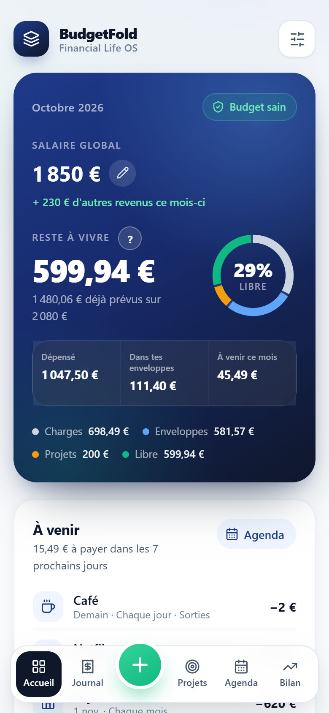
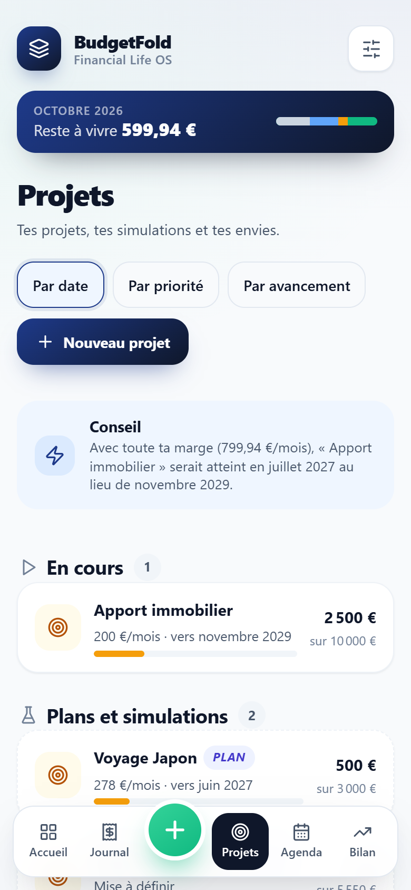
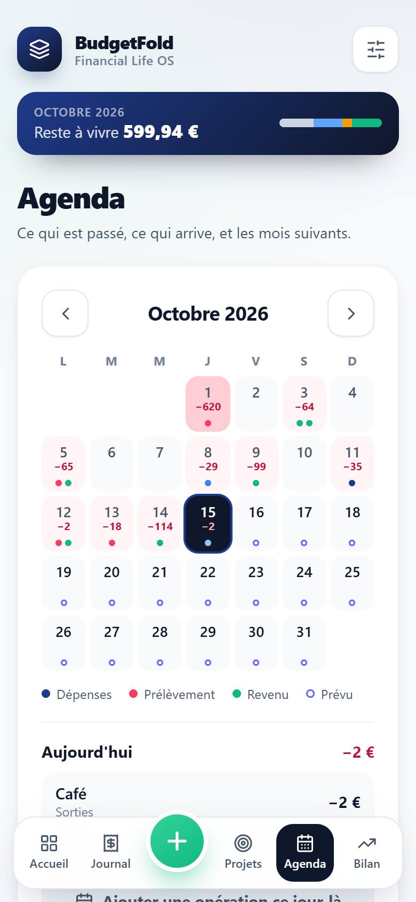
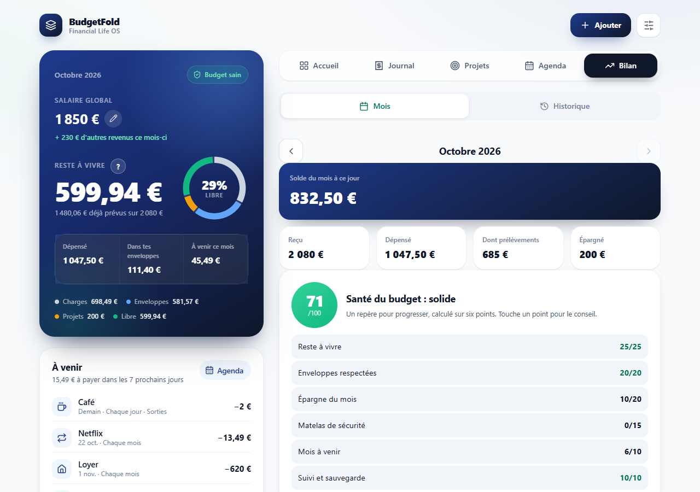

# BudgetFold OS

**Ton budget par enveloppes, qui prévoit tes mois à venir, gratuit, en français, et tes données ne quittent jamais ton téléphone.**

Application web installable (PWA) pour étudiants, familles et jeunes actifs. Version **1.0.0** · [Journal des versions](CHANGELOG.md) · [Guide d'utilisation](docs/guide.md)

| Accueil | Projets | Agenda |
|---|---|---|
|  |  |  |

## Ce que fait BudgetFold
- **Reste à vivre** du mois, calculé à partir de tes revenus, prélèvements, enveloppes et projets.
- **Enveloppes** (plafonds) par semaine, mois ou plus, avec couleur et icône ; mois budgétaire au jour de paie.
- **Clôture de mois** guidée : reporter, remettre au budget ou épargner ce qui reste. Historique figé de chaque mois.
- **Projets et simulations** : mise mensuelle, date visée ou réserve, trois scénarios, conseils.
- **Agenda** : échéancier, trésorerie jour par jour, prévisions sur 6 mois, export vers le calendrier du téléphone.
- **Tickets** : scan (lecture sur l'appareil), facture PDF, photo gardée comme justificatif, ticket réparti entre enveloppes.
- **Bilan** : score de santé, suggestions, rapports, historique.
- **Comptes** multiples et rapprochement avec la banque ; import CSV des grandes banques ; abonnements repérés.
- **Micro-entreprise** (facultatif) : chiffre d'affaires, cotisations mises de côté, alertes de seuils.
- **Sécurité** : code et Face ID, sauvegarde chiffrée, transfert par QR code. Thèmes clair, sombre et rose.

## Confidentialité
Aucun serveur, aucun compte, aucun traceur. Tout reste dans le navigateur de l'appareil (stockage local et IndexedDB). Le détail est dans l'app : menu › Confidentialité.

## Utiliser
- **En ligne** : GitHub Pages (Settings › Pages › branche `main`), puis « Ajouter à l'écran d'accueil » sur iPhone ou « Installer » sur Android et ordinateur.
- **Hors ligne, en un seul fichier** : `BudgetFold.html` (ouvrable directement, même sans internet ; le scan de ticket et la lecture de PDF ont besoin d'internet la première fois).
- **En local** : `npm install`, puis `npm start` et http://localhost:5173.

## Développer
- HTML, CSS et JavaScript **sans framework ni build** : modules ES dans `js/` (voir `CLAUDE.md`).
- `npm test` : syntaxe des modules, puis tous les tests dans un vrai navigateur (Puppeteer) — calculs, récurrences, clôture, projets, tickets et OCR, justificatifs, sécurité, interface, appareils, captures de référence.
- `npm run test:fast` : tous les tests sauf l'OCR et les captures.
- `npm run test:refs` : régénère les captures de référence (après un changement visuel voulu).
- `npm run audit` : audit Lighthouse mobile (chaque note doit être ≥ 90).
- `npm run build:single` : régénère `BudgetFold.html`. `npm run build:icons` : régénère `js/icons.mjs` après avoir utilisé une nouvelle icône.
- Avant chaque version : [liste de contrôle](docs/checklist.md).

## Licences
Icônes [Lucide](https://lucide.dev) (ISC), lecture des tickets [Tesseract.js](https://tesseract.projectnaptha.com) (Apache 2.0), PDF [pdf.js](https://mozilla.github.io/pdf.js/) (Apache 2.0), QR [qrcode-generator](https://github.com/kazuhikoarase/qrcode-generator) (MIT), police Inter (OFL).
